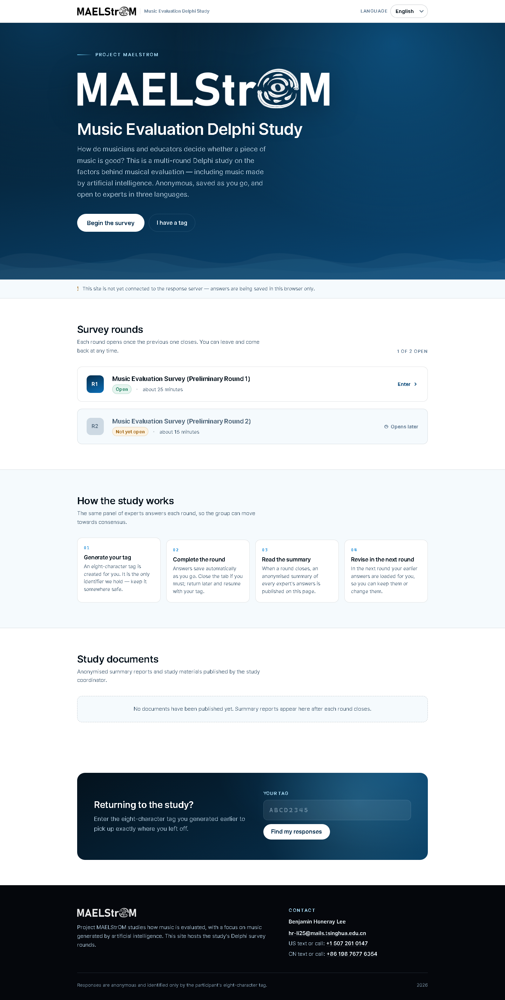
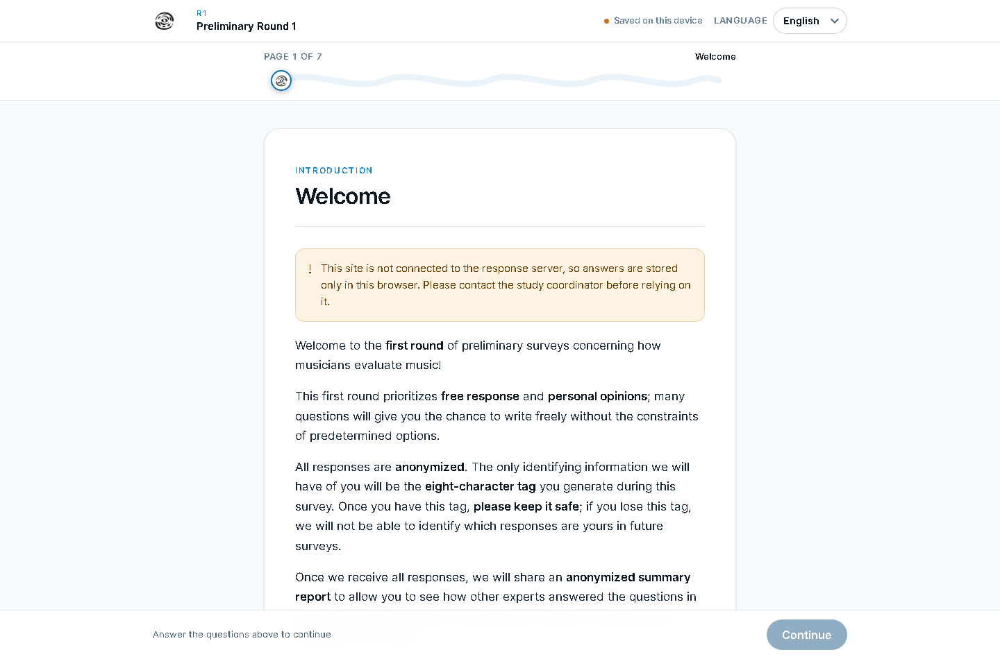

# MAELStrOM study site

The website for **Project MAELStrOM**'s multi-round Delphi study on how musicians evaluate
music, including music generated by artificial intelligence.

It hosts a homepage that lists every survey round, and the survey rounds themselves
(Round 1 and Round 2 at present). It is a plain static site: no build step, no bundler,
no dependencies. GitHub Pages serves it, and a small Cloudflare Worker stores responses
in a **private** GitHub repository.

- **Homepage** — `index.html`
- **Survey runner** — `survey.html?s=<survey-id>`
- **Languages** — English, 中文, Français, switchable at any point without losing answers
- **Storage** — 10-second autosave to the browser *and* to the study server
- **Recovery** — participants return with their eight-character tag





*(Both screenshots were taken with no response server configured, which is why the amber
"not connected" strip is visible. It disappears once `apiBase` is set.)*

---

## 1. Quick start

```bash
# from the repository root
python tools/serve.py          # http://127.0.0.1:8080
```

Open <http://127.0.0.1:8080/>. The site works immediately; without a configured
response server it shows a warning strip and keeps answers in the browser only.

> Opening `index.html` directly from disk will **not** work: browsers block ES modules
> and JSON fetches on `file://`. Always use the local server.

Useful URLs:

| | |
|---|---|
| Homepage | `http://127.0.0.1:8080/` |
| Round 1 | `http://127.0.0.1:8080/survey.html?s=delphi-round-1` |
| Round 2 | `http://127.0.0.1:8080/survey.html?s=delphi-round-2` |
| Force a language | `?lang=zh` / `?lang=fr` / `?lang=en` |

## 2. Deploying

Three things are deployed, in this order: the **data repository** (private), the
**worker**, then the **site**.

Full instructions, including the exact permissions each token needs, are in
[`docs/DEPLOY.md`](docs/DEPLOY.md). The short version:

1. Create a **private** repository `maelstrom-study-data` — the response store.
2. Create a Cloudflare KV namespace and deploy `worker/` to Cloudflare Workers. It holds
   a fine-grained GitHub token and commits responses into the data repository.
3. Put the worker URL in `assets/js/config.js` → `apiBase`.
4. Create a **public** repository `honeray/maelstrom-study`, push, then **enable** Pages
   under **Settings → Pages → Deploy from a branch → main / (root)**.

> **The site repository must be public.** GitHub Free publishes Pages only from public
> repositories; a private one needs GitHub Pro/Team/Enterprise. And a successful
> `git push` never publishes a site by itself — Pages must be switched on in the
> repository settings. If you skip either point, `https://honeray.github.io/maelstrom-study/`
> answers *"There isn't a GitHub Pages site here."* even though the push succeeded.
> This is safe: the public repository holds only the questionnaire and its UI, while all
> responses live in the private `maelstrom-study-data` repository.

The site then lives at <https://honeray.github.io/maelstrom-study/>. All asset paths are
relative, so the sub-path works without any configuration (the repository name becomes
the URL path).

## 3. Repository layout

```
index.html                 Homepage: round banners, documents, tag recovery
survey.html                Survey runner shell (one page, driven by JSON)
404.html                   Not-found page
assets/
  css/                     base.css (tokens + shared UI), home.css, survey.css
  js/
    config.js              ★ the file you edit to point at the worker
    lib/                   i18n, storage, api client, UI helpers
    survey/                schema loader, state, renderer, runner
    pages/home.js          Homepage behaviour
  img/                     Logos, favicon, social card (generated from ../Logo)
data/
  site.json                Contact details, optional site-wide notice
  surveys.json             ★ the survey manifest (id, file, status, order)
  surveys/*.json           ★ one self-contained file per survey round
i18n/                      UI strings: en.json, zh.json, fr.json
reports/                   Summary reports, catalog.json, generated manifest.json
worker/                    Cloudflare Worker that stores responses
docs/                      Deployment, authoring, translation, privacy notes
tools/                     Local server, validator, image builder
.github/                   Action that rebuilds reports/manifest.json
```

Files marked ★ are the ones you will normally edit.

## 4. Adding a new survey round

Adding Round 3 is a two-file change. Full details in
[`docs/ADDING-A-SURVEY.md`](docs/ADDING-A-SURVEY.md).

1. Create `data/surveys/delphi-round-3.json` (copy Round 1 and edit).
2. Add one entry to `data/surveys.json`:

   ```json
   { "id": "delphi-round-3", "file": "data/surveys/delphi-round-3.json",
     "code": "R3", "order": 3, "status": "scheduled" }
   ```

3. `status` controls the homepage: `scheduled` (greyed, "opens later"), `open`
   (clickable), `closed` (greyed, "closed"). Flip it when the round opens.

4. If the new round reuses an earlier round's questions, do not copy them — reference
   them:

   ```json
   { "include": { "from": "delphi-round-2", "pages": ["demographics", "factors"] },
     "with": { "title": { "en": "Revisions", "zh": "修订", "fr": "Révisions" } } }
   ```

5. Run `npm run validate` before pushing. It checks JSON shape, ids, includes,
   translations and links.

## 5. Publishing a summary report

1. Drop the file into `reports/` (PDF, DOCX, CSV — anything a browser can open).
2. Commit and push.

The GitHub Action regenerates `reports/manifest.json`; the homepage picks it up and
shows it as a document banner. To control the title and ordering, add an entry to
`reports/catalog.json`:

```json
{ "name": "round-1-summary.pdf", "title": "Round 1 summary report",
  "description": "Anonymised summary of Round 1.", "order": 1 }
```

## 6. Languages

- Interface strings: `i18n/en.json`, `i18n/zh.json`, `i18n/fr.json` (identical key sets;
  the validator enforces this).
- Survey content: stored inline in each survey file as `{ "en": "…", "zh": "…", "fr": "…" }`,
  so a survey is a single self-contained document.
- **The Chinese and French translations are drafts and must be reviewed by a fluent
  speaker before the study goes live.** See [`docs/TRANSLATIONS.md`](docs/TRANSLATIONS.md).

## 7. Data, anonymity and the tag

Participants never create an account. They generate an **eight-character tag** which is
the only identifier the study holds. It acts as a bearer key: whoever knows a tag can
retrieve that participant's answers, so participants are told to keep it private.

Responses are stored in a **private** repository; only the static site is public. See
[`docs/DATA-AND-PRIVACY.md`](docs/DATA-AND-PRIVACY.md) for the record schema, the export
path to CSV, and the retention guidance.

## 8. Maintenance commands

```bash
npm run serve       # local preview at http://127.0.0.1:8080
npm run validate    # check surveys, i18n, includes and report links
npm run manifest    # rebuild reports/manifest.json locally
npm run check       # validate + verify the manifest is up to date
npm run doctor      # why is (or isn't) the published site reachable?
```

Regenerating the image assets from the master artwork in `../Logo`:

```powershell
powershell -ExecutionPolicy Bypass -File tools/build-images.ps1
```

## 9. Browser support

Evergreen Chrome, Edge, Firefox and Safari (2022 or newer). The site uses ES modules,
`structuredClone` with a JSON fallback, and `Intl`. It is keyboard navigable, respects
`prefers-reduced-motion`, and needs no cookies and no third-party requests.

## License

Code is provided for the MAELStrOM study. The MAELStrOM name and logo remain the
property of the project.
