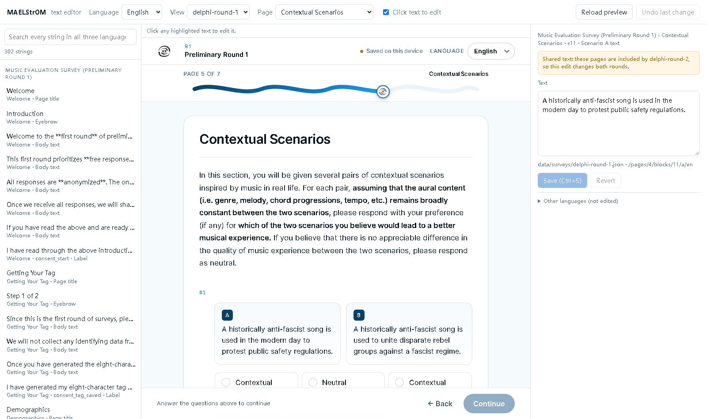

# Editing the site text without touching code

The editor lets you change any sentence on the site — in English, Chinese or
French — by clicking it in a live preview of the real page. It is for study
prose, questions, options, interface labels and the contact block. It does not
change the survey's structure, and it never touches the other two languages.



```bash
npm run edit
```

A browser opens at `http://127.0.0.1:8123/editor/`. Stop the server with
Ctrl+C when you are finished.

## What you are looking at

| Area | What it does |
|---|---|
| Left | Every string on the site, grouped by round and page, searchable across all three languages. |
| Middle | The actual site, rendered by the actual code, in an iframe. Highlighted text is editable. |
| Right | The editor for the string you picked, with the other two languages shown read-only. |

**Pick a string** by clicking it in the middle, or by choosing a row on the left.
The right panel shows where the string lives (`data/surveys/…json · /pages/3/…/prompt/en`),
a warning when the page is shared with another round, and a text box.

**Save** with the button or Ctrl+S. The file is written immediately and a diff
panel shows the exact line that changed. **Undo last change** reverts it.

## The language switch

The language selector changes the preview *and* the text you are editing. With
`中文` selected, clicking a question opens its Chinese value; saving rewrites
only the `zh` key. English and French are untouched — they live in separate keys
of the same JSON object.

## The “Click text to edit” switch

While it is on, clicking a piece of text opens it for editing instead of acting
like the real site. Turn it off to answer the survey normally (tick options,
press Continue); you can still open a string for editing with Alt+click.

The **Page** selector jumps straight to any page, so you do not have to answer
your way through the survey.

## Shared text

Round 2 reuses several Round 1 pages. A string on one of those pages shows:

> Shared text: these pages are included by delphi-round-2, so this edit changes both rounds.

That is expected: the text lives in Round 1's file and both rounds read it.
Edit it once and both are correct.

## Working in a spreadsheet

**Export CSV** downloads every string on the site — survey prose, questions,
options, interface labels and contact text — as one row per string:

| column | meaning |
|---|---|
| `id` | Stable identifier. **Do not edit or rename it** — it is how the row is matched on import. |
| `group`, `context` | Where the string appears, for orientation. Ignored on import. |
| `file`, `pointer`, `page` | Exact source location, for reference. Ignored on import. |
| `en`, `zh`, `fr` | The three values. **These are the only columns written back.** |
| `shared` | Which rounds reuse this page, if any. |

Edit the `en` / `zh` / `fr` cells, save, then press **Import CSV…**. Only cells
whose text actually differs are written; everything else is skipped, and the
report says how many changed, how many already matched and which rows were
skipped. Importing the same file twice is harmless — the second time reports
"nothing to change".

An import is applied as **one action**, so **Revert this import** undoes the
whole sheet in a single click, even after hundreds of cells.

Practical notes:

- Use a UTF-8 CSV. In Excel that is *Save as → CSV UTF-8 (comma delimited)*.
  The export carries a byte-order mark, so Excel shows Chinese and French
  correctly; do not save as "CSV (MS-DOS)".
- The separator is detected, so a sheet saved with semicolons (common in
  French-locale Excel) imports fine.
- Excel turns a cell starting with `=` into a formula. If a sentence must start
  with `=`, edit that one in the panel instead.
- Cells may contain commas, quotes and line breaks; they are quoted correctly in
  both directions.
- An empty cell means "delete this text". The import warns about each one, and
  `npm run validate` catches the cases the survey does not allow.
- Rows with an unrecognised `id` are reported and skipped; the rest of the file
  is still applied.

This is the recommended route for a translator: send them the CSV, ask for the
`zh` or `fr` column back, and import it.

## Saving, committing, publishing

The editor writes to the files in your working copy and does nothing else — no
commit, no push, no GitHub access at all. When you are happy:

```bash
git diff            # read what changed
git add -A
git commit -m "text: refine the scenario instructions"
git push            # GitHub Pages publishes in about a minute
```

`npm run validate` checks the JSON is still well formed before you commit.

## Safety properties worth knowing

- **One language at a time.** Only the edited key is rewritten.
- **Formatting is preserved.** The editor replaces the single string literal in
  place rather than re-serialising the file, so a typical edit is a one-line
  diff — not a whole-file reformat.
- **Nothing reaches the live site.** The preview's response API is redirected to
  a collector inside the editor process, so practising on the survey cannot
  create records in the production data store.
- **Only local.** The server binds to `127.0.0.1` and refuses cross-origin
  writes. It is not reachable from other machines, and the copy of the editor
  published on GitHub Pages cannot write anything.
- **Your answers are not saved.** The preview does not persist a draft, so a
  reload starts the survey fresh.

## Troubleshooting

**“This editor needs its local server.”** You opened the published page instead
of the local one. Run `npm run edit` and use the address it prints.

**The port is busy.** The server tries 8123, then the next few ports, and prints
the one it chose. `npm run edit -- --port=8300` forces a port.

**A text looks right in the preview but is missing from the list.** The list is
built from the JSON files; if you have just added text by hand, restart the
editor server.

**I saved something wrong.** Press **Undo last change** straight away. Later,
undo is still available in the same session (up to the last 200 edits); after a
restart, use `git diff` and `git checkout -- <file>`.

**A machine-drafted translation is being edited.** Chinese and French are still
drafts until a native speaker reviews them — see `docs/TRANSLATIONS.md`.
